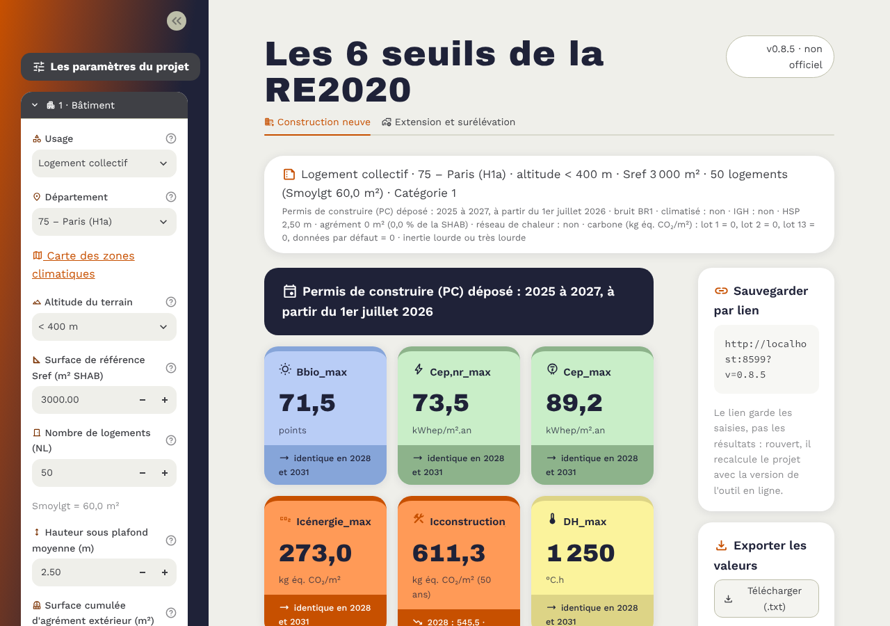

# Les 6 seuils de la RE2020

Un outil en ligne qui calcule les six seuils réglementaires de la RE2020 pour un projet
de construction neuve : Bbio_max, Cep,nr_max, Cep_max, Icénergie_max, Icconstruction_max
et DH_max.

**Utiliser l'outil : [seuils-re2020.streamlit.app](https://seuils-re2020.streamlit.app/)**

> Document non officiel. Les résultats doivent être vérifiés avant tout usage réglementaire.
> Version 0.8.7, version de travail.



---

# Partie 1 : pour les utilisateurs

## À quoi ça sert

Vous renseignez les caractéristiques de votre projet (type de bâtiment, département,
altitude, surface, nombre de logements…). L'outil affiche aussitôt les six seuils à
respecter, avec leur unité, puis le détail du calcul.

Il est fait pour les projets dont le permis de construire est déposé à partir du
1er juillet 2026 (décret n° 2026-200).

## Comment l'utiliser en quatre étapes

1. **Ouvrir la page** : [seuils-re2020.streamlit.app](https://seuils-re2020.streamlit.app/).
   Le premier chargement peut prendre quelques secondes.
2. **Renseigner le menu de gauche**, étape par étape : bâtiment, permis de construire,
   contraintes extérieures, carbone, réseau de chaleur, label. Seuls les champs utiles au
   type de bâtiment choisi apparaissent. Le point d'interrogation (?) à côté de chaque champ
   en donne la définition.
3. **Lire les résultats** : six cartes colorées, une par seuil. Chaque carte indique si le
   seuil reste identique en 2028 et 2031 ou s'il évolue.
4. **Garder une trace** : voir « Sauvegarder et exporter » ci-dessous.

Le menu s'ouvre par défaut. Sur téléphone, il recouvre la page : le refermer avec le
bouton « « » en haut à gauche.

## Sauvegarder et exporter

- **Sauvegarder par lien** : l'adresse de la page contient toutes vos saisies. Copiez-la
  pour retrouver votre projet plus tard. Le lien ne garde que les saisies : rouvert, il
  recalcule le projet avec la version en ligne de l'outil. Aucune donnée n'est stockée
  sur un serveur.
- **Télécharger (.txt)** : un fichier texte avec les six seuils, leurs formules et les
  valeurs des modulations. Il existe aussi une copie dans le presse-papiers.

## Les alertes

Une alerte apparaît pour les constructions de **50 m² ou moins** : elles relèvent
d'exigences de moyens, et non de la RE2020 complète.

## Ce que l'outil ne fait pas encore

- **Extensions et surélévations** : l'onglet existe mais est en préparation.
- **Projets mixtes** (plusieurs usages dans un même bâtiment) : pas de calcul au prorata
  des surfaces.
- **IGH** : l'interprétation de la règle pour les immeubles de grande hauteur en 2031 est à
  confirmer (voir partie 2).

## Pour en savoir plus sur la réglementation

- [Site officiel de la RE2020](https://rt-re-batiment.developpement-durable.gouv.fr/re2020-r320.html)
- [La RE2020 sur Wikipédia](https://fr.wikipedia.org/wiki/R%C3%A9glementation_environnementale_2020)
- [Carte des zones climatiques](https://alliages.github.io/zones-climatiques-re2020/)

---

# Partie 2 : pour les développeurs et les relecteurs

## Installer et lancer en local

Il faut Python 3.10 ou plus récent ([python.org](https://www.python.org/downloads/)).
Ouvrir un terminal dans le dossier du projet, puis :

**Windows (PowerShell ou invite de commandes)**

```
python -m venv .venv
.venv\Scripts\python -m pip install -r requirements.txt
.venv\Scripts\python -m streamlit run app.py
```

Si `python` n'est pas reconnu, remplacer le premier `python` par `py`. Sous Windows, il n'y a
pas besoin d'« activer » l'environnement.

**macOS et Linux**

```bash
python3 -m venv .venv
.venv/bin/python -m pip install -r requirements.txt
.venv/bin/python -m streamlit run app.py
```

L'application s'ouvre sur http://localhost:8501. Pour l'arrêter : `Ctrl + C`.

## Utiliser le moteur sans interface

Le calcul est indépendant de Streamlit et s'utilise directement en Python :

```python
from seuils_re2020 import Projet, calculer

projet = Projet(usage_id=2, zone="H1a", altitude="<400m", sref=3000,
                periode_pc="2028 à 2030", nb_logements=50)
resultats = calculer(projet)
print(resultats["bbio_max"].valeur, resultats["bbio_max"].coefficients)
```

Les numéros d'usage se trouvent dans `donnees/usages.csv`.

## Organisation du dépôt

```
app.py                  interface Streamlit (point d'entrée)
interface/              style (palette), icônes (icones.py), sauvegarde par lien (lien.py)
seuils_re2020/          moteur de calcul, sans dépendance à Streamlit
  variables.py          paramètres et listes de choix, regroupés en tête
  regles.py             description du projet, date du décret 2026-200, choix des règles
  calculs.py            assemblage des six seuils
  export.py             récapitulatif, évolution 2028/2031, export texte
  controles.py          alertes de cohérence des saisies
  expressions.py        évaluation sûre des formules de donnees/regles.csv
  donnees.py            lecture des tables
donnees/                valeurs réglementaires et infobulles (CSV, séparateur « ; »)
tests/                  cas de référence et tests automatiques
outils/                 extraction depuis le classeur Excel, banc de test LibreOffice, diagnostic
.streamlit/config.toml  thème (couleurs, polices)
static/polices/         Work Sans et Archivo Black (licence SIL OFL)
docs/                   captures d'écran du README
CHANGELOG.md            journal des versions
```

## Données et sources

Aucune valeur réglementaire n'est écrite dans le code. Tout est dans `donnees/`, et chaque
ligne indique la cellule du classeur d'où elle provient (colonne `source`).

- **Tables simples** : valeurs moyennes, Mbgéo, Mcgéo, Migéo, Mccat, Mbbruit, seuils des lots…
- **`regles.csv`** : modulations qui dépendent de la surface, de la date ou d'autres saisies,
  écrites en formules lisibles, par exemple `(47.5 - (0.095 * sref)) / bbiomaxmoyen`.
- **`aides.csv`** : infobulles reprises de la colonne I de l'onglet de saisie du classeur.
  **`aides_complements.csv`** : définitions de l'annexe pour les autres champs.

Textes de référence : annexe à l'article R. 172-4 du code de la construction et de l'habitation
(décrets 2021-1004, 2022-305, 2024-1258, 2026-16) et décret n° 2026-200 du 18 mars 2026.

Après une mise à jour du classeur, régénérer les données puis relancer les tests :

```
python outils/extraire_excel.py outils/calcul_seuils_RE2020_NU_v2.2.xlsx <classeur_recalcule.xlsx> donnees
python -m pytest
```

## Vérifier le calcul

Le moteur est comparé au classeur Excel de référence (v2.2) sur **10 670 cas** : 28 usages
croisés avec zones, altitudes, périodes, surfaces, bruit, catégories, lots carbone, hauteur
sous plafond, agrément, réseau de chaleur, IGH et date du permis. L'écart toléré est de 10⁻⁶.

```
python -m pip install pytest
python -m pytest
```

`tests/test_cas_reference.py` porte la comparaison Excel. Les autres tests couvrent l'export,
l'évolution 2028/2031 et l'interface (affichage, lien de sauvegarde). Ils tournent aussi à
chaque envoi sur GitHub (`.github/workflows/tests.yml`).

**Fichiers à relire en priorité** : `donnees/regles.csv` et `donnees/aides.csv` (valeurs et
formules), `seuils_re2020/calculs.py` (assemblage des six seuils) et
`seuils_re2020/regles.py` (choix des règles selon la date de dépôt).

## Limites connues

- **Extensions et surélévations** : onglet en préparation.
- **IGH en 2031** : le classeur retient 95 % de la valeur 2028 standard. Une lecture littérale
  du décret donnerait 95 % de la valeur IGH 2028. Interprétation à confirmer.
- **DH Effinergie** : le bonus « exposition au bruit » du classeur ne se déclenche jamais.
  Reproduit tel quel, à corriger d'abord dans le classeur puis ici.
- **Multi-usages** : pas de calcul au prorata des Sref.

## Versions

Version 0.8.x tant que l'outil n'est pas validé, puis 0.9. Chiffre pair = évolution importante,
chiffre impair = correction. Détail dans `CHANGELOG.md`.

## Licence et crédits

GNU GPL v3, comme le classeur d'origine. Polices Work Sans et Archivo Black : SIL Open Font
License 1.1 (`static/polices/`).

Guillaume Meunier, d'après son classeur `calcul_seuils_RE2020_NU`. Le passage du classeur à la
version 2.0 (indicateurs carbone et énergie des nouveaux usages) est dû à Félix Dubois (CSTB).
Corrections signalées par Cédrick Gbegnon, Léonard Forissier et Félix Dubois.

## Faire un lien vers l'outil (usage externe)

Un lien peut ouvrir l'outil avec des saisies déjà renseignées. Les paramètres absents
prennent leur valeur par défaut.

Exemple : bureaux (usage 3), altitude 400 à 800 m, tout le reste par défaut :

    https://seuils-re2020.streamlit.app/?v=0.8.7&usage=3&alt=400m-800m

Le paramètre `v` indique la version de l'outil qui a produit le lien. Il n'est pas utilisé
à la lecture : le lien est recalculé avec la version en ligne.

| Paramètre | Champ du menu | Valeurs admises | Défaut |
|---|---|---|---|
| `usage` | Usage | numéro `id` de `donnees/usages.csv` (1 maison, 2 logement collectif, 3 bureaux…) | 2 |
| `dep` | Département | nom tel qu'affiché dans le menu (ex. `Paris`) | Paris |
| `alt` | Altitude | `<400m`, `400m-800m`, `>800m` | `<400m` |
| `sref` | Surface de référence (m²) | nombre ≥ 1 | 3000 |
| `nl` | Nombre de logements | entier ≥ 1 | 50 |
| `combles` | Combles aménagés de moins de 1,8 m (m²) | nombre ≥ 0 | 0 |
| `hsp` | Hauteur sous plafond (m) | nombre ≥ 2 | 2.5 |
| `agr` | Surface cumulée d'agrément extérieur (m²) | nombre ≥ 0 | 0 |
| `pc` | Période de dépôt du PC | `2022 à 2024`, `2025 à 2027`, `2028 à 2030`, `à partir de 2031` | `2025 à 2027` |
| `juillet` | PC déposé à partir du 1er juillet 2026 | 1 ou 0 | 1 |
| `cat` | Catégorie | 1, 2 ou 3 | 1 |
| `bruit` | Exposition au bruit | BR1, BR2 ou BR3 | BR1 |
| `clim` | Bâtiment climatisé | 1 ou 0 | 0 |
| `igh` | Immeuble de grande hauteur | 1 ou 0 | 0 |
| `rcu` | Raccordé à un réseau de chaleur | 1 ou 0 | 0 |
| `classe` | Réseau classé | 1 ou 0 | 0 |
| `inertie` | Classe d'inertie | `Très légère, légère ou moyenne`, `Lourde ou très lourde` | `Lourde ou très lourde` |
| `lot1` | Lot 1 – VRD | nombre ≥ 0 | 0 |
| `lot2` | Lot 2 – fondations et infrastructure | nombre ≥ 0 | 0 |
| `lot13` | Lot 13 – production locale d'électricité | nombre ≥ 0 | 0 |
| `ded` | Données par défaut et forfaits (Icded) | nombre ≥ 0 | 0 |

Règles d'écriture :

- Les `<` et `>` de `alt` s'écrivent `%3C` et `%3E` (`alt=%3C400m`, `alt=%3E800m`).
- Les espaces et accents des valeurs texte (`pc`, `inertie`) sont encodés par le navigateur.
- Les cases à cocher s'écrivent `1` (oui) ou `0` (non).
- Les décimales s'écrivent avec un point (`hsp=2.7`).
- `juillet` n'a d'effet que si `pc` vaut `2025 à 2027`.
